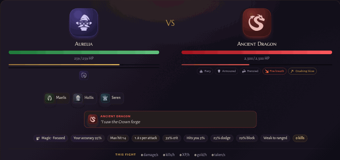
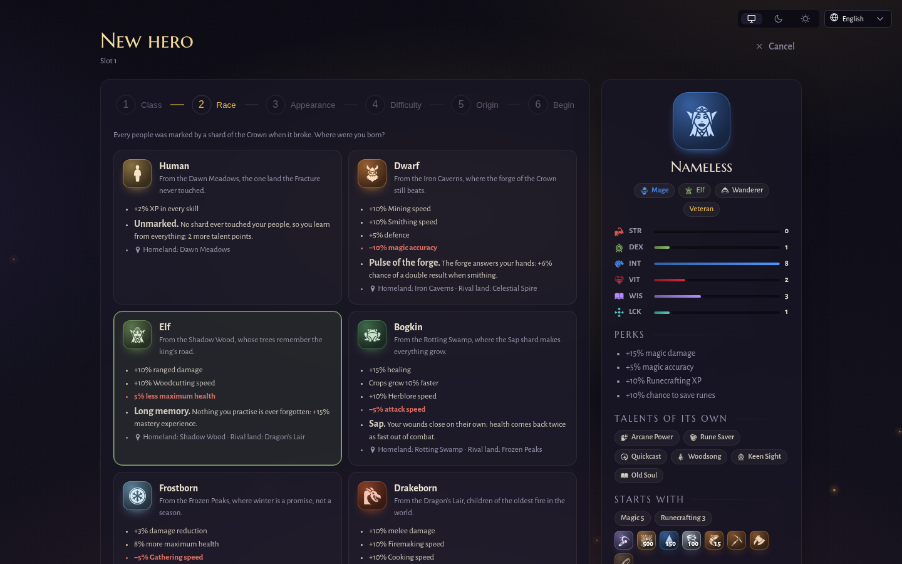
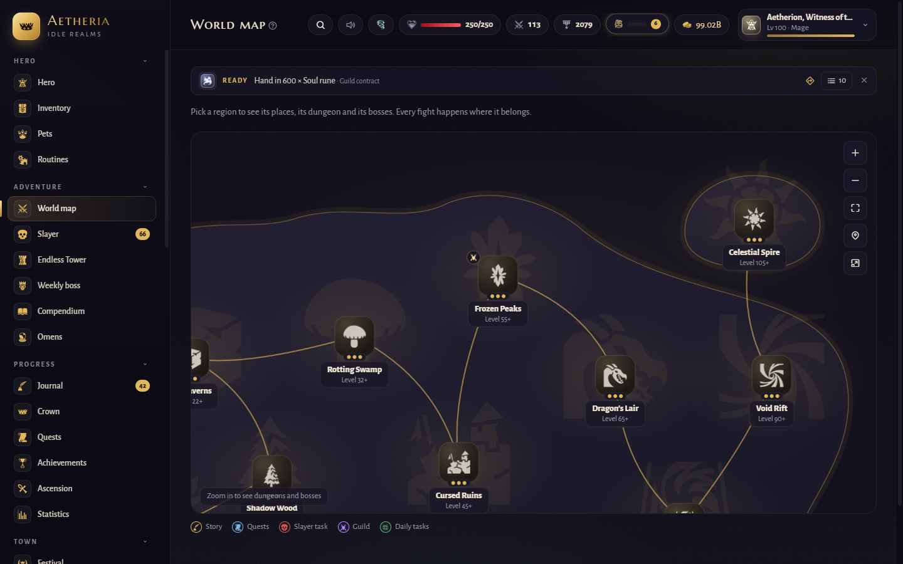
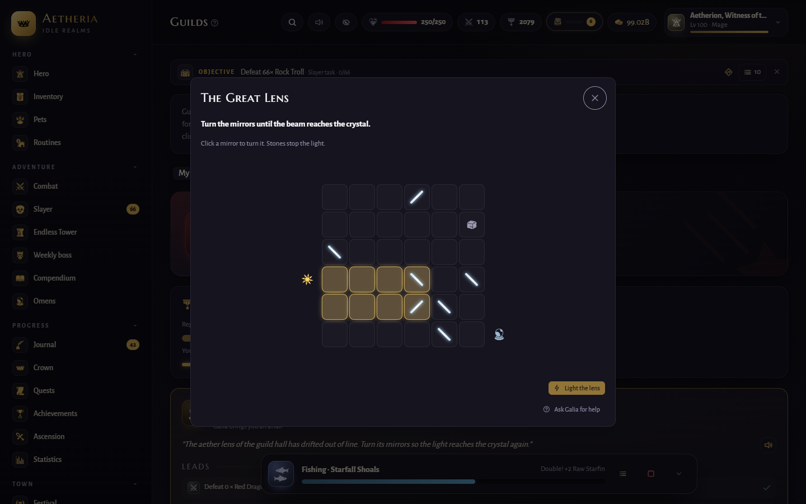
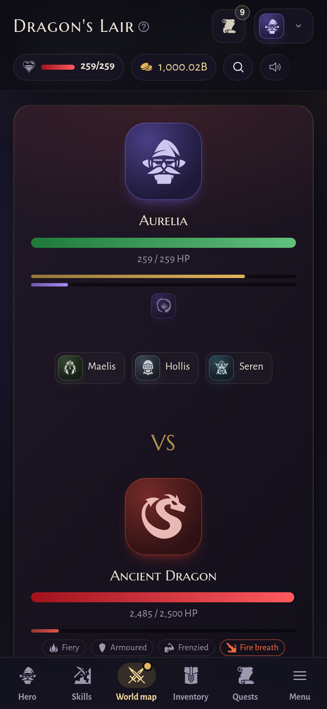
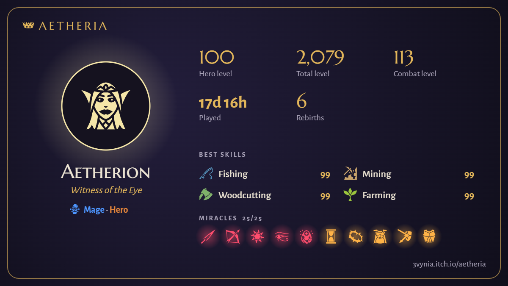

<p align="center">
  
</p>

<p align="center">
  <a href="https://3vynia.github.io/Aetheria/"></a>
  <a href="https://3vynia.itch.io/aetheria"></a>
</p>

<p align="center">
  <a href="https://github.com/3Vynia/Aetheria/actions/workflows/ci.yml"></a>
  <a href="https://github.com/3Vynia/Aetheria/releases"></a>
  
  <a href="#languages"></a>
  <a href="LICENSE"></a>
</p>

**Aetheria** is a fantasy idle RPG that runs in the browser. Pick one of seven peoples, train 21 skills, fight your way across a map of the realm from the Dawn Meadows to the top of the sky with a company of companions at your side, join a guild and settle its affairs, hang the trophies of the bosses you beat in a house that works for you, raise pets, chase ultra rare finds and follow a story told in chapters, with voices for every character. Your hero keeps working while you are away.

No download, no account, no ads. It installs as an app on desktop and phones, keeps working offline, and your saves never leave your device unless you choose to share them.

<p align="center">
  
</p>

## Highlights

- **21 skills** for gathering, crafting and fighting, each with mastery, prestige and a twist of its own.
- **Deep combat:** a map of the realm, thirteen stances, abilities with tactics rules, weapon statuses, creatures with moves of their own, elites, boss phases and mechanics, dungeons, an endless tower, slayer tasks and a weekly boss.
- **A company at your side:** companions who fight with you, five of them met along the story with a quest and a voice of their own, who set out on expeditions while you are busy and live in your house when they stay behind.
- **A tavern to run:** staff who work and grow, expedition crews, a bar, and ten table games from the King's Twenty-One to an arm-wrestling ladder and a bards' duel in rhyme.
- **A house that works:** a floor plan of ten rooms, a trophy for every boss you beat, rooms that grow, cook, study and earn while you are away, and beds for your companions.
- **A story with voices:** six acts, three endings, a journal you can read aloud and characters you can talk to, every one with a voice of their own.
- **Guilds with real puzzles:** affairs followed up out in the realm and settled by deduction, ciphers, light beams, astrolabes, scales and rites.
- **Make the hero yours:** six classes, seven races with a homeland and talents of their own, seven origins, four difficulties, attributes, talents, titles and portraits.
- **Rebirth:** start over for permanent upgrades, live a life under a trial and look back on every life you have lived.
- **Miracles:** 25 ultra rare finds, with a card to share when one drops.
- **A living world:** weather that follows the real seasons, rare omens, regions that grow restless, festivals and fairs.
- **Generative music and voices** made with WebAudio. There is not a single audio file.
- **Built to last:** automatic backups, transfer links, offline progress and a save that repairs itself.

## Languages

<!-- translations:start -->
| Language | Progress | | Texts |
|---|---|--:|--:|
| English | `████████████████████` | 100% | 5,997 / 5,997 |
| Español | `████████████████████` | 100% | 5,997 / 5,997 |
| 한국어 | `████████████████████` | 100% | 5,997 / 5,997 |
| 日本語 | `████████████░░░░░░░░` | 59% | 3,566 / 5,997 |
| 简体中文 | `░░░░░░░░░░░░░░░░░░░░` | 0% | 0 / 5,997 |
| Português (Brasil) | `░░░░░░░░░░░░░░░░░░░░` | 0% | 0 / 5,997 |
| Русский | `░░░░░░░░░░░░░░░░░░░░` | 0% | 0 / 5,997 |
| Deutsch | `░░░░░░░░░░░░░░░░░░░░` | 0% | 0 / 5,997 |
| Français | `░░░░░░░░░░░░░░░░░░░░` | 0% | 0 / 5,997 |

English and Spanish are complete with every update. The other languages are translated a little at a time; whatever is not translated yet reads in English, and a language appears in the game's language menu once it passes 50%.
<!-- translations:end -->

## Screenshots

<table>
  <tr>
    <td width="50%"></td>
    <td width="50%"></td>
  </tr>
  <tr>
    <td></td>
    <td></td>
  </tr>
  <tr>
    <td></td>
    <td></td>
  </tr>
  <tr>
    <td></td>
    <td></td>
  </tr>
</table>

<p align="center">
  
  
  
</p>

## Features

<details>
<summary><b>Your hero</b></summary>

- **Character creation** in six steps:
  - **Class:** Warrior, Ranger, Mage, Artisan, Rogue or Paladin, each with how it fights, a rating for combat, gathering, crafting and toughness, its own talents and its starting kit.
  - **Race:** human, dwarf, elf, bogkin, frostborn, drakeborn or starborn, the peoples marked by the shards of the Crown. Each has its strengths and one weakness, a trait of its own, three racial talents, and a homeland and rival land where it fights better or worse.
  - **Appearance:** name, portrait and colour.
  - **Difficulty:** four of them, explained in plain words (pace, monster strength, gold, progress while away and what dying costs).
  - **Origin:** the one thing the hero remembers when they wake. Six origins give a small head start and a line of their own in the first page of the journal, and the wanderer brings only the mystery.
  - **Begin:** a summary, the guided tutorial and a menu that grows as you play, both optional.
- **21 skills** across gathering, artisan, support and combat, with per-action mastery and up to ten prestiges each. The speed of every skill lists where it comes from, source by source.
- **Hero level (1–100)** fed by 25% of all skill XP. Every level grants attribute points (STR, DEX, INT, VIT, WIS, LCK) and every second level a talent point. The combat power panel shows where every number comes from.
- **Tools:** tiered pickaxes, axes and fishing rods gate advanced resources; a sickle makes crops grow faster and yield more, and lockpicks make thieving faster and safer.
- **Techniques:** every skill has a twist of its own. Mining strikes rich veins, woodcutting fells whole trees, smithing and fletching build momentum, cooking keeps a steady hand, herblore finds focus, firemaking feeds a hearth that keeps warming you, and runecrafting resonates with the weather and the night.
- **Crafting quality:** gear comes out Fine, Superior or Masterwork, more often the better you know the recipe. Mage robes are woven in four cloths and ranger hides stitched from pelts, skins and scales.
- **Titles and appearance:** 52 titles, plus extra portraits and colours unlocked by achievements and festivals.
- **Hero cards:** a picture of the hero to share or keep (levels, play time, rebirths, best skills and miracles found), and a card for every miracle with its odds and who found it. Drawn on the device and shared, downloaded or copied from there.

</details>

<details>
<summary><b>Combat</b></summary>

- **10 areas, 7 world bosses, 6 dungeons**, an endless tower, slayer tasks, prayers and a company of companions.
- **World map:** every region on one board that can be dragged, zoomed and opened full screen. Each region has its own page with its places, dungeon and bosses, and fights happen there. The map marks where the hero is fighting and where the story, quests, the slayer task and guild work are waiting. Combat setup lives in a Preparation window opened from any place where you fight.
- **Weapons and armour:** every weapon has its own attack speed, crit chance and sometimes a status it leaves (bleeding, burns, poison, stuns, slows or weakness). Agility dodges, shields block and armour soaks part of every blow.
- **Stances:** thirteen across melee, ranged and magic. Each trades accuracy, damage, speed or defence and shares the XP its own way, and the combat screen compares them all against the creature you face.
- **Abilities:** six per style, unlocked by level. Attacks build energy, and up to three abilities fire on their own in priority order.
- **Creatures:** traits (venom, armour, regeneration, life drain, frenzy, evasion), rare elites with far better loot, and **hunting streaks** that add up to +25% combat XP and loot.
- **Creature moves:** every creature past the first meadow charges a move of its own (a bleeding, poisoned, burning or stunning strike, a frenzy, hardened armour, fading out of reach, regrowing, or a thief that runs off with gold). Elites bring one more. Stunning or slowing a creature while it charges cuts the move off.
- **Bosses:** each has its own big moves (crushing blows, fire breath, frost novas, venom sprays, mending), charged with a warning before they land. A guarding stance takes them far better, and damage dealt while a boss mends breaks the heal. Bosses turn enraged and then desperate as they weaken, and **speak in their own voice** when the fight begins, at each phase and when they fall.
- **Echoes:** once the story has an ending, every world boss returns stronger; beating each echo adds a lasting bonus to every life.
- **Endless tower:** weekly twists on every block of floors, named guardians every tenth floor, and the best climbers of the realm's guilds racing the hero to the top.
- **Slayer:** three hunts to pick from, Superior creatures, sigils for the slayer helm, perks, blocked creatures and streak rewards.
- **Weekly boss:** a different boss every week, the same for every player, with a mechanic of its own, wounds that last all week and an exclusive trophy.
- **A realm that reacts:** every region grows restless with time and calms down with every creature hunted there. Overrun regions are stronger and richer, and calming them pays a bounty.
- **Tactics and loadouts:** retreat before falling, stop when the slayer task is done, guard during boss and creature charges, and five saved loadouts with their stance and ability bar. Ability rules answer a creature's move with a stun or a slow, defend below a chosen health and break an enemy's healing with the hardest hitter.
- **The company:** companions hired for good, one of each trade. Up to two come along for a wage to every fight but the endless ones of a region (bosses, dungeons, the weekly boss, the tower, omens and festivals), three with the War Banner of rebirth:
  - **squires** draw blows and take part of charged strikes, **archers** cut off creatures' moves, **mages** break healings and **clerics** mend the hero and lift bleeding, poison and burns;
  - they level up with every kill, earn trust, fight better once loyal and stay through rebirth;
  - **five companions met along the way** join through the story and the guild, each better at their trade, with a bonus outside the fights, a quest of their own at full trust and a voice in the journal.
- **Endgame beyond the Abyss:** the Void Rift and the Celestial Spire, aether gear and boss-only uniques.

</details>

<details>
<summary><b>Story and voices</b></summary>

- **Journal:** the story of Aetheria in chapters that unlock as you explore, beat bosses and witness omens. Six acts take it from the Dawn Road to the top of the sky, with three endings. Every game rolls a new cast of names, and the story knows which people the hero was born to.
- **Voices:** characters speak in short sung syllables made with WebAudio, with no audio files and no real words, so they sound the same in every language. Each person has a timbre of their own, questions rise and statements fall, and the words appear in step with the voice.
  - A new journal page is told by a narrator, and any page can be read again or stopped.
  - **Talk** to everyone you have met: what they say grows with the story, including the old prophecy of the one who remembers.
  - Quest givers tell their quests and thank you when they are done, the tavern keeper greets you back, the astrologer reads her notes on omens and studied creatures have their lore read.
- **The Aether Crown:** the seven shards of the story as something you hold. Up to three sit in the circlet for a lasting bonus and a power, and with the Crown whole the hero chooses whom it goes to. Every ending chosen stays for all later lives.
- **Omens:** twelve rare phenomena that arrive unannounced, each with its own cryptic sign: Blood Moons, Arcane Eclipses, a Gilded Goblin to chase, a Wandering Rift, a Comet of Wishes and more, with pets, relics, wishes and boons found nowhere else.
- **Weather:** the sky changes every three hours, the same for every player, with rarer storms, heatwaves and blizzards that follow the real seasons. Weather, season and night all change modifiers.
- **Festivals and fairs:** four festivals a year, each with its own activity, shop, pet and story, and a fair on the second weekend of every other month.

</details>

<details>
<summary><b>Guilds and town</b></summary>

- **Guilds:** every new world founds twelve guilds with their own name, crest, motto, guildmaster, members, tier and focus. Members take contracts, climb six ranks, earn a perk and spend marks in the guild shop.
  - **Entry trials:** each guild sets those who would join it an enigma of the kind it favours.
  - **Affairs:** now and then a guild mate brings an affair instead of a contract. It is followed up out in the realm through its leads (creatures, skills and a word with someone from the journal), every lead found reveals more, and it ends with an enigma:
    - **deduction:** suspects from the guild's own roster, clues heard lead by lead and a grid to work them out on;
    - **cipher:** a letter in a shifting alphabet, read back with dials, answered by typing the place it names;
    - **beam:** mirrors turned on a grid to lead the light to a crystal;
    - **astrolabe:** rings of stars turned under a pointer, some dragging the next ones along;
    - **balance:** one false coin found with a few weighings;
    - **echo:** a rite of runes that sounds and grows, sung back from memory.

    Every enigma is made for your save and always has an answer. A guild mate can help for marks, and wrong answers cost time.
- **Tavern:** staff with specialities, rarities, traits and levels who work for a wage, daily orders, a mystery chest, a bar with patrons and special guests, and brews of your own.
  - **Staff growth:** workers grow seasoned at levels 25, 50 and 75, shedding a bad trait or learning a good one, and can be promoted to the next rarity.
  - **Expeditions:** crews of adventurers and companions sent out for one to twelve hours. Every trade helps on the road, events along the way can be turned away by the right trade, companions do better on ground they know, and a trip can repeat on its own.
  - **Table games:** ten of them, grouped by chance, skill and wits: the King's Twenty-One against the keeper, dice, knucklebone and the rune shell game; darts, horseshoes, a ladder of seven arm-wrestling rivals and a drinking contest; three men's morris and a bards' duel answered in rhyme. All played for gold up to the tavern's limit.
- **Thieving:** heat, jail, the fence and four heists that play out in stages.
- **Farming:** plots that grow in real time, compost, seasons, pests, bountiful harvests, hybrids crossed from two parent crops, and a farmyard with a coop, a beehive, a scarecrow and a well.
- **Fishing waters:** five waters with their own fish, bait, and a scene with the line, the bobber and the latest catches.
- **Church:** blessings, a daily offering for favour, holy water and twelve combat prayers.
- **Home:** a floor plan of ten rooms that speed up skills, crafting and combat.
  - **Trophies:** every boss and dungeon lord leaves one once beaten enough times, hung in a room for a bonus that stays through rebirth.
  - **Rooms at work:** the greenhouse, kitchen, library and vault make crops, dishes, study notes and interest on their own, up to twelve hours at a time.
  - **Companions at home:** those who stay behind sleep there, gaining trust, training in the armory and healing sooner.
- **Routines:** up to twelve rules of the form "when this happens, do that", with eight ready-made rules to start from.

</details>

<details>
<summary><b>Collecting and rebirth</b></summary>

- **Miracles:** 25 ultra rare finds that every skill action and every kill rolls for: epic tools and charms (about 1 in 50,000), legendary gear and the Hourglass of Ages (down to 1 in 250,000), and five mythic items at one in a million. Epic and legendary finds keep a streak that makes a long-overdue one up to three times likelier. Finds are locked, kept through rebirth and listed in the Compendium.
- **Ascension:** start the whole hero over for Aether shards and spend them in a tree of permanent upgrades. The next life can be born as another race, and every race a life is completed with adds XP for good.
  - **Trials:** live the next life under a rule (Fasting, Arcane, Self-made or Frail) for extra shards and a lasting bonus.
  - **Past lives:** every life is written down when it ends and listed on the Rebirth screen.
- **Pets:** 34 rare companions that hatch from eggs. Name, feed and pet them; they learn alongside you, grow their bond and bring gifts.
- **Compendium:** a bestiary of every creature defeated, item pages that pay a bonus when full, masterworks, and the Miracles.
- **Equipment sets:** 23 sets with bonuses for two to five pieces worn.
- **Enchanting:** every equipment slot from +1 to +10.
- **Relic forge:** reforge, fuse and reshape omen relics with the exact odds shown first.
- **Achievements, daily and weekly tasks** with a streak, and **weekly records** compared with your best week.

</details>

<details>
<summary><b>Sound</b></summary>

- **Fifty themes on shuffle:** from the tavern's jig and the workshop's anvils to the chapel's organ, rain on the roof and songs of the road. They play in a random order, a few minutes each, wherever you are, or you can keep one. Each is written in its own mode and composed as it plays, in phrases built on a motif of its own, with harmony that moves smoothly from chord to chord.
- **Synthesised instruments:** plucked lute and harp, bells and celesta, bowed strings, a choir on real vowels, organ, a breathy flute, horns, frame drums, tambourine and timpani. Plucked and struck notes are rendered once and replayed, so they cost almost nothing.
- **Fights raise the music:** drums come in when a fight is on screen, and at low health the music dulls under a heartbeat.
- **A real mix:** every theme plays in its own room (a warm tavern, a long cave, a vast cathedral), through an EQ, a bus compressor, gentle saturation and a limiter, with themes evened out to the same loudness.
- **Ambience** that follows the weather and the region you fight in.
- **Sound effects** built in layers from the same instruments, with a little variation every time, in three packs.
- **Voices** sung on the vowels of their words, with consonants and a throat of their own for every character.
- **A sound screen** with a live picture of the music, the library of themes and the full mixer.
</details>

<details>
<summary><b>Comfort and accessibility</b></summary>

- **Tracking board:** a button beside the hero counts everything on the go and turns green when something is ready. Its board sorts it into story, jobs, tavern and tasks, and every line takes you where it is done.
- **Search** for any screen, skill, item, creature or quest (<kbd>Ctrl</kbd>+<kbd>K</kbd> or <kbd>/</kbd>), and **keyboard shortcuts** for the main screens (<kbd>?</kbd> lists them).
- **Action queue** and **chained crafting:** when a recipe runs out, the game makes the missing materials first and goes back to it.
- **Guided tutorial** and a **menu that grows** as screens become useful.
- **In-game help:** a "?" on every screen and section, and full item cards on hover or tap.
- **Accessibility:** text size, less motion, captions, visual alerts, soft treble and mono sound, text that reaches WCAG AA contrast in both themes, named controls and a skip link for keyboard users.
- **Light and dark themes**, a phone layout with a bottom navigation bar, and an installable app that works offline.
- **Offline progress** up to a cap that grows as you play.

</details>

<details>
<summary><b>Saves</b></summary>

- **Four save slots**, saved every few seconds, when the tab is hidden and on close.
- **Backups:** every slot keeps a recent copy, one from about an hour ago and one from about a day ago, and a deleted game can be recovered from the title screen.
- **Transfer:** download the save as a file or send yourself a link that opens the hero on another device. No account or server involved.
- **Sealed saves:** saves, files and transfer links are encrypted and authenticated (XChaCha20-Poly1305, 256-bit), so they cannot be read or edited outside the game. Old plain saves still open: the player's own are sealed as they are, and outside files go through a plausibility review first.
- **Creator saves** are signed with a post-quantum signature (ML-DSA-65, FIPS 204). The game only holds the public key.
- **One tab per game**, so two copies never overwrite each other.
- **A save that repairs itself:** a broken number is never written, and the game asks the browser to keep its storage.
- **Feedback:** a Settings section to report a bug or share an idea with the details that help. Nothing is sent on its own.

</details>

## Built with

| | |
|---|---|
| **Framework** | [Vue 3](https://vuejs.org/) with `<script setup>`, [PrimeVue 4](https://primevue.org/) |
| **Build** | [Vite](https://vite.dev/), with a single-file build that runs straight from disk |
| **Languages** | [vue-i18n](https://vue-i18n.intlify.dev/): English and Spanish complete with every update and seven more languages translated a little at a time (see [Languages](#languages)), every key checked in CI |
| **Sound** | WebAudio only: music, ambience, alerts and voices are all synthesised |
| **Quality** | [Vitest](https://vitest.dev/) (over 590 tests, including real saves from every earlier version) and [ESLint](https://eslint.org/) |
| **Hosting** | GitHub Pages as an installable, offline-ready app, and itch.io |

There is no backend: the whole game runs in the browser and saves to `localStorage` and IndexedDB.

## Getting started

Requires Node.js 18 or newer.

```bash
npm install
npm run dev            # dev server at http://localhost:5173
```

| Command | What it does |
|---|---|
| `npm run build` | Production build in `dist/` |
| `npm run build:single` | The whole game in one HTML file, in `dist-single/` |
| `npm test` | Run the test suites |
| `npm run lint` | Check the code with ESLint |
| `npm run check:i18n` | Make sure every language has every key |
| `npm run balance` | XP/hour, gold/hour and combat estimates for every level |
| `npm run icons` | Rebuild `src/game/icons.json` and check every icon name |

### Save key

Published builds seal saves with a key kept in the `SAVE_KEY` repository secret; a published build without it stops instead of using the public development key. For local builds put the same key in `.env.local` as `VITE_SAVE_KEY=…` (ignored by git). Without one, a development key is used and its saves only open in other development builds. **Never change or lose the key once players have saves sealed with it.**

Creator saves are made with `node scripts/creator.mjs keygen` (once) and `node scripts/creator.mjs sign <save>`. The private key stays in `~/.config/aetheria/creator.key`, outside the repository.

Every push runs lint, the translation check, the tests and a build. A tag such as `v1.0.0-beta.14` publishes a release with both builds and its notes from `docs/releases/`.

## Project layout

| Folder | What lives there |
|---|---|
| `src/game/data/` | All game content and tuning: skills, items, actions, creatures, quests, achievements, guilds, enigmas and more. Balance and new content live here. |
| `src/game/` | The engine: reactive state and the systems mixed into it, the game loop, saves, music, sound and voices. |
| `src/views/`, `src/components/` | The screens and their parts. |
| `src/ui/` | Helpers for the screens: tooltips, tracking, item sources, hero cards. |
| `src/i18n/` | vue-i18n setup and the `en` / `es` message files. Game data only stores ids; names are looked up as they are shown. |
| `public/` | App manifest, service worker and icons. |
| `scripts/` | Icon extraction, the translation checker and the balance report. |
| `tests/` | Vitest suites, with save fixtures from every public version. |
| `docs/` | Screenshots and release notes. |

<details>
<summary>The engine, module by module</summary>

- `engine.js`: reactive state, saving, levels, modifiers and the main update, with offline simulation.
- `inventory.js`, `skilling.js`, `combat.js`, `progress.js`: items and gear; skill actions with fishing and farming; fights and the tower; quests, achievements, the church and prestige.
- `races.js`, `home.js`: the hero's people, and the house's trophies, rooms at work and companions at home.
- `loop.js`: game loop, offline progress, autosave and one tab per game.
- `systems.js`: tavern, staff and their growth, expedition crews, orders, queue, loadouts, prayers, market, events and history.
- `company.js`: the company of companions, their part in fights, trust and quests.
- `tavernGames.js`: the tavern's table games.
- `meta.js`: pet rolls, enchanting and daily / weekly tasks.
- `fighting.js`: weapon pace, crits, statuses, traits, elites, abilities and their rules, boss phases, boss and creature moves, streaks and combat power.
- `guilds.js` and `affairs.js`: guilds, entry trials, contracts, ranks, perks, the shop and guild affairs. The enigmas themselves are pure generators in `data/enigmas.js`.
- `ascension.js`: rebirth, its upgrade tree, trials and past lives.
- `mythics.js`: ultra rare finds and their luck streak.
- `journal.js`: chapters, memories and what the tavern keeper and the people of the story say.
- `crown.js`: the Aether Crown's shards, sockets, powers and endings.
- `omens.js`, `realm.js`, `weekly.js`, `slayer.js`, `echoes.js`: omens, regional threat, the weekly boss, slayer and echoes.
- `companions.js`, `relicforge.js`, `codex.js`, `collection.js`: pets, the relic forge, the compendium, sets, the bestiary and cosmetics.
- `farm.js`, `bar.js`, `thief.js`, `church.js`, `techniques.js`, `routines.js`, `festivals.js`: the farm, the tavern bar, thieving, the church, skill techniques, routines and festivals.
- `music.js`, `sound.js`, `voices.js`, `audioProfiles.js`: generative music and ambience, sound alerts, character voices and sound profiles.
- `backup.js`, `transfer.js`, `saveGuard.js`: backups, save files and transfer links, and the guard that keeps broken numbers out of saves.
- `tutorial.js`, `unlocks.js`, `feedback.js`, `updates.js`: the guided first steps, the growing menu, bug reports and the new version notice.

</details>

## Feedback

Found a bug or have an idea? Use the **Feedback** section in Settings, leave a comment on [itch.io](https://3vynia.itch.io/aetheria) or [open an issue](https://github.com/3Vynia/Aetheria/issues/new). The in-game report adds the version, your device and your hero, so it is easy to follow up.

## Adding a language

1. Copy `src/i18n/locales/en.js` to a new file (for example `fr.js`) and translate the values. Keep every `{placeholder}` as it is.
2. Register it in `LOCALES` and `messages` in `src/i18n/index.js`.
3. Run `npm run check:i18n`.

## Credits

- Icons from [game-icons.net](https://game-icons.net) by Lorc, Delapouite and contributors, licensed under [CC BY 3.0](https://creativecommons.org/licenses/by/3.0/).
- Fonts: [Marcellus SC](https://fonts.google.com/specimen/Marcellus+SC) and [Alegreya Sans](https://fonts.google.com/specimen/Alegreya+Sans) from Google Fonts.

## License

[MIT](LICENSE)
