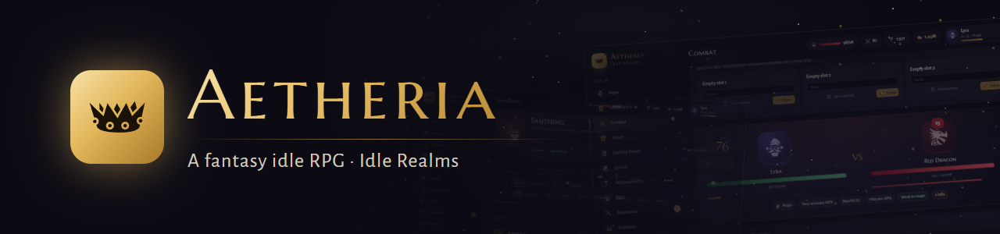
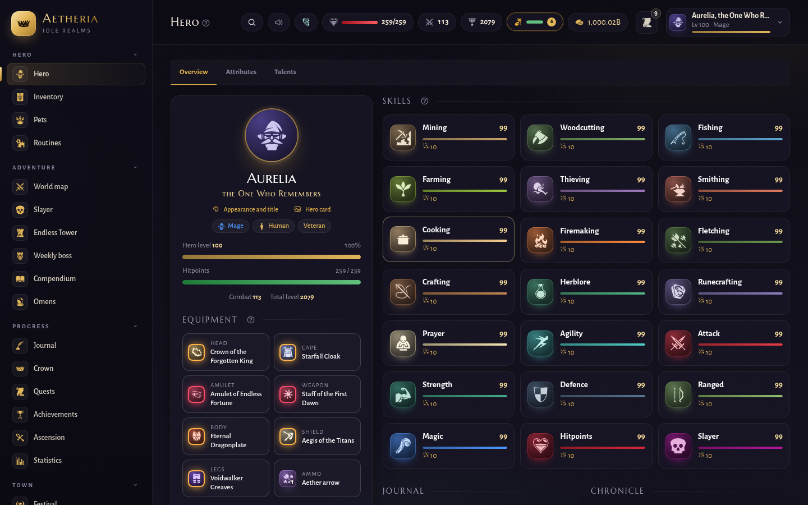
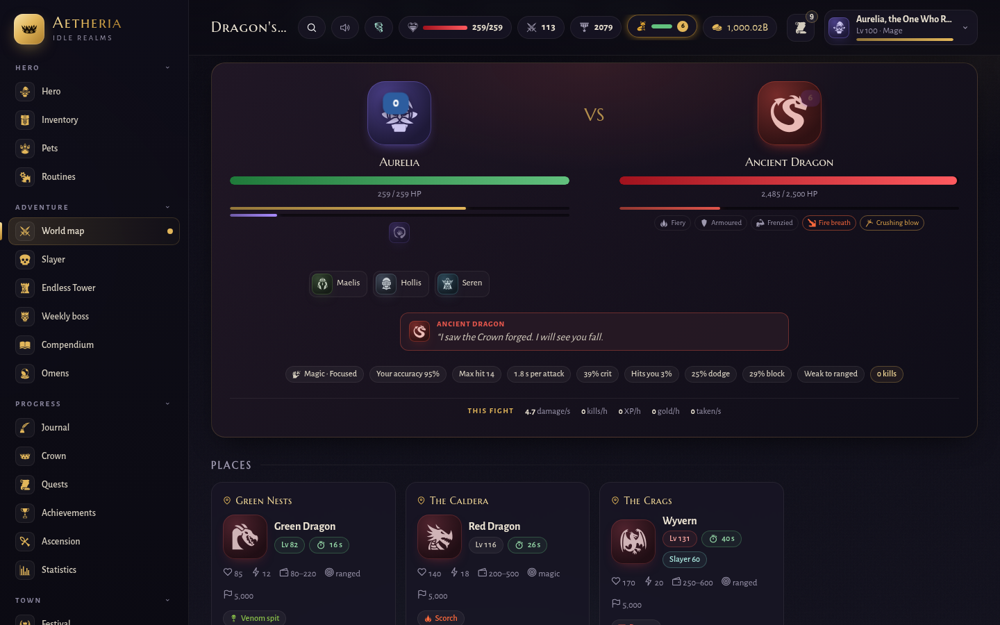
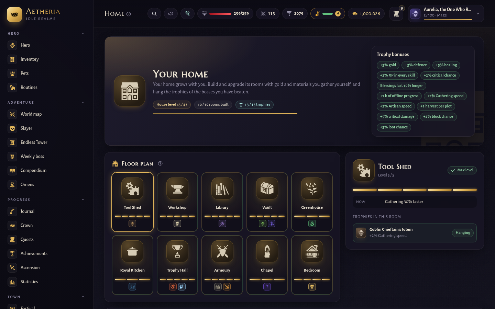
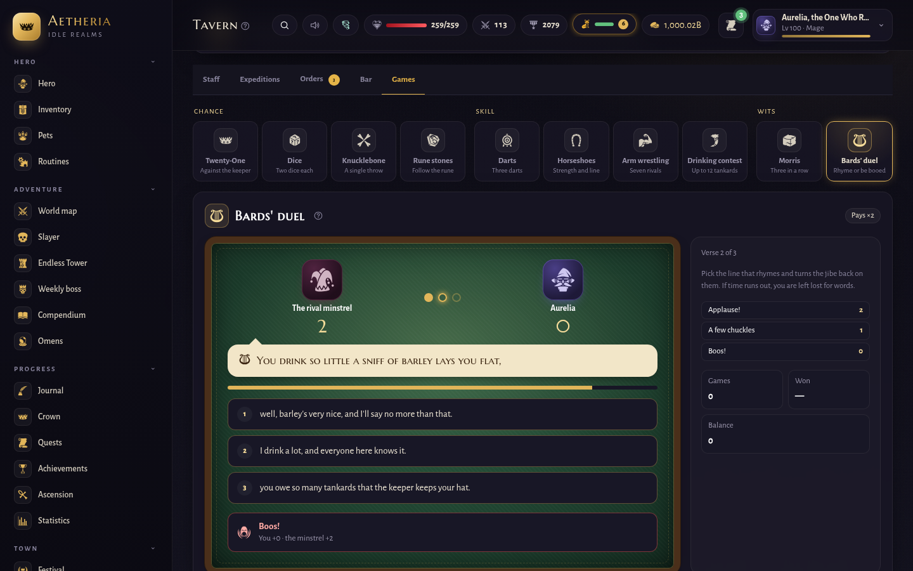
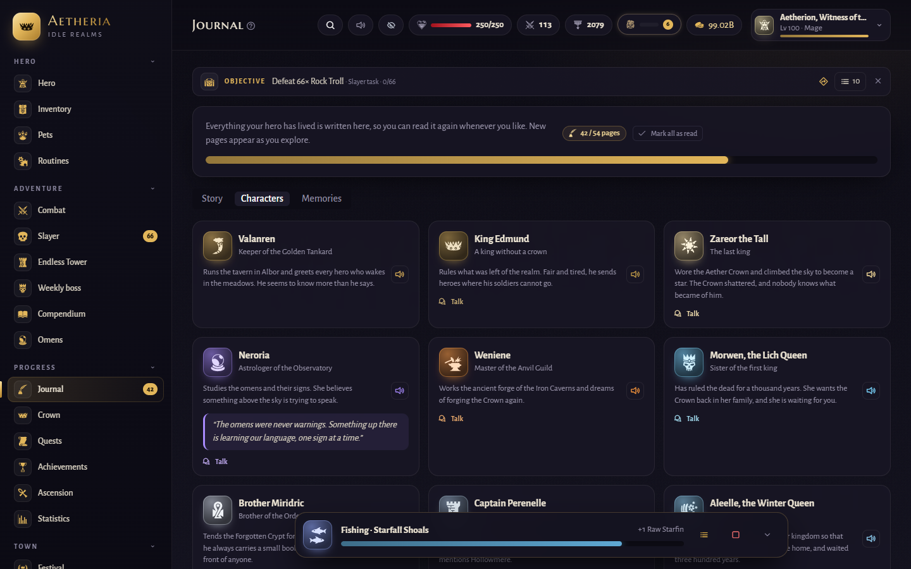
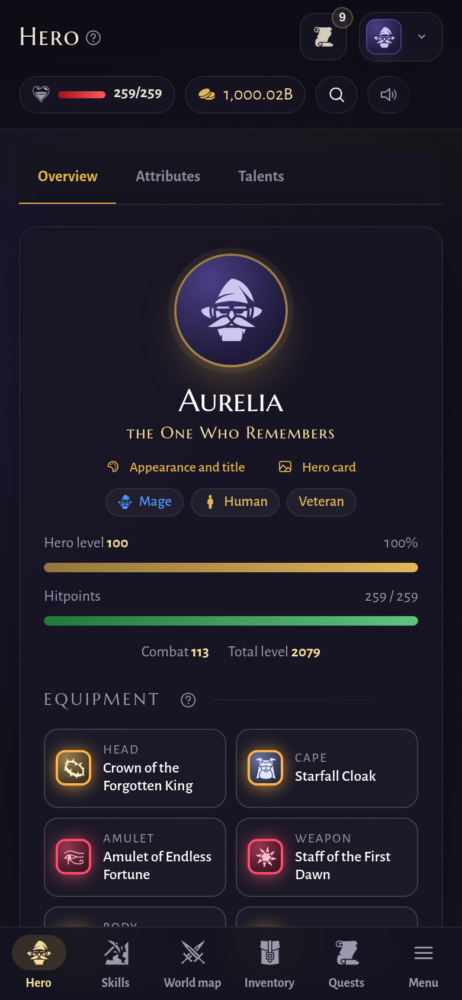

<div align="center">



<h1>Aetheria</h1>
<h3>A fantasy idle RPG for the browser, where your hero keeps working while you are away</h3>

<p>
  <a href="https://github.com/3Vynia/Aetheria/releases"></a>
  <a href="https://github.com/3Vynia/Aetheria/actions/workflows/ci.yml"></a>
  <a href="LICENSE"></a>
  <a href="#-languages"></a>
</p>

<p>
  <a href="https://3vynia.github.io/Aetheria/"></a>
  <a href="https://3vynia.itch.io/aetheria"></a>
</p>

</div>

<hr>

<h2>📜 About</h2>

<table width="100%">
  <tr valign="middle">
    <td width="60%">
      <p>Pick one of seven peoples, train 21 skills and fight your way across a map of the realm, from the Dawn Meadows to the top of the sky, with a company of companions at your side.</p>
      <p>Join a guild and settle its affairs, hang the trophies of the bosses you beat in a house that works for you, raise pets, chase ultra rare finds and follow a story told in six acts, with a voice for every character.</p>
      <blockquote><b>⚔️ Close the tab, come back tomorrow: your hero kept going.</b></blockquote>
    </td>
    <td width="40%" align="center">
      <p>🛡️ <b>No account, no ads</b><br><sub>Nothing to sign up for. Your saves stay on your device.</sub></p>
      <hr width="80%">
      <p>📱 <b>Install it anywhere</b><br><sub>Works on desktop and phones, and keeps working offline.</sub></p>
      <hr width="80%">
      <p>🎵 <b>Not a single audio file</b><br><sub>Music, ambience and voices are made live in the browser.</sub></p>
    </td>
  </tr>
</table>

<h2>📸 Screenshots</h2>

<p align="center">
  
</p>

<table align="center">
  <tr valign="top">
    <td align="center"><b>Your hero</b><br><br></td>
    <td align="center"><b>The arena</b><br><br></td>
  </tr>
  <tr valign="top">
    <td align="center"><b>Map of the realm</b><br><br></td>
    <td align="center"><b>A house that works</b><br><br></td>
  </tr>
  <tr valign="top">
    <td align="center"><b>Tavern games</b><br><br></td>
    <td align="center"><b>Guild affairs</b><br><br></td>
  </tr>
  <tr valign="top">
    <td align="center"><b>Seven peoples</b><br><br></td>
    <td align="center"><b>The journal</b><br><br></td>
  </tr>
</table>

<p align="center">
  
  
  
</p>

<h2>✨ Features</h2>

### 🧙 Your hero
- **Six classes, seven races, seven origins** and four difficulties, explained in plain words.
- **21 skills** with mastery, prestige and a technique of their own: rich veins, felled trees, a hearth that keeps burning…
- **Hero levels, attributes and talents**, with every number of your power broken down.
- **Crafting quality:** gear comes out Fine, Superior or Masterwork as you master the recipe.
- **52 titles**, portraits and colours, and a **hero card** to share.

### ⚔️ Combat
- **A map of the realm:** 10 regions, 7 world bosses, 6 dungeons, an endless tower and a weekly boss.
- **Thirteen stances, eighteen abilities** and tactics rules your hero follows on their own.
- **Creatures with moves of their own:** stun or slow them while they charge to cut them off.
- **Bosses** with phases, big moves and a voice, and **echoes** that come back stronger after the story ends.
- **The company:** squires, archers, mages and clerics who fight at your side, plus five companions met along the story.

### 📖 Story and world
- **Six acts and three endings**, a new cast of names in every game, and characters you can talk to.
- **The Aether Crown:** gather its seven shards, set them for their powers and choose whom it goes to.
- **Twelve omens**, weather that follows the real seasons, and **four festivals** a year with fairs in between.
- **A realm that reacts:** regions grow restless when left alone and pay a bounty once calmed.

### 🏰 Town and guilds
- **Guilds** with entry trials, contracts, ranks and **affairs** solved with deduction, ciphers, light beams, astrolabes, scales and rites.
- **A tavern** with staff, expedition crews, a bar full of patrons and **ten table games**, from the King's Twenty-One to a bards' duel in rhyme.
- **A house that works for you**, with trophies, rooms that produce on their own and beds for your companions.
- **Farming, fishing, thieving and the church**, each with mechanics of its own.
- **Routines:** rules like "when food runs low, cook".

### 💎 Collecting and rebirth
- **25 miracles**, ultra rare finds down to one in a million.
- **Rebirth** with an upgrade tree, trials and a record of past lives.
- **34 pets** to hatch, feed and bond with, a **compendium**, equipment sets, enchanting and a relic forge.

### 🎵 Sound
- **Fifty themes on shuffle**, composed as they play on synthesised lutes, harps, strings, choir and drums.
- **Voices** sung on real vowels, with a timbre of their own for every character.
- **A full mixer**, sound profiles and thirty alerts you can tune one by one.

### ♿ Comfort and accessibility
- **Text size, colour-blind friendly colours, high contrast and plain letters.**
- **Captions, visual alerts, soft and mono sound**, and fewer animations.
- **Search, keyboard shortcuts, a tracking board**, a guided tutorial and a menu that grows with you.
- **Automatic backups and transfer between devices**, with nothing ever leaving your device unless you share it.

<h2>🌍 Languages</h2>

<!-- translations:start -->
<table align="center">
  <tr><td align="center"><b>English</b><br></td><td align="center"><b>Español</b><br></td><td align="center"><b>한국어</b><br></td></tr>
  <tr><td align="center"><b>日本語</b><br></td><td align="center"><b>简体中文</b><br></td><td align="center"><b>Português (Brasil)</b><br></td></tr>
  <tr><td align="center"><b>Русский</b><br></td><td align="center"><b>Deutsch</b><br></td><td align="center"><b>Français</b><br></td></tr>
</table>
<!-- translations:end -->

<h2>📥 Play</h2>

<div align="center">

<p>
  <a href="https://3vynia.github.io/Aetheria/"></a>
  <a href="https://3vynia.itch.io/aetheria"></a>
  <a href="https://github.com/3Vynia/Aetheria/releases/latest"></a>
</p>

<p><sub>Any modern browser on desktop or phone · install it from the browser menu to play it as an app</sub></p>

</div>

<h2>🛠️ Built with</h2>

| Part | Tools |
|---|---|
| **Framework** | [Vue 3](https://vuejs.org/) and [PrimeVue 4](https://primevue.org/) |
| **Build** | [Vite](https://vite.dev/), plus a single-file build that runs straight from disk |
| **Languages** | [vue-i18n](https://vue-i18n.intlify.dev/), every key checked in CI |
| **Sound** | WebAudio only: music, ambience, alerts and voices are synthesised |
| **Quality** | [Vitest](https://vitest.dev/) with 600 tests, including real saves from every earlier version, and [ESLint](https://eslint.org/) |
| **Hosting** | GitHub Pages and itch.io, no backend |

<details>
<summary><b>💻 Run it locally</b></summary>

<br>

Requires Node.js 18 or newer.

```bash
npm install
npm run dev
```

| Command | What it does |
|---|---|
| `npm run build` | Production build in `dist/` |
| `npm run build:single` | The whole game in one HTML file, in `dist-single/` |
| `npm test` | Run the test suites |
| `npm run lint` | Check the code with ESLint |
| `npm run check:i18n` | Check every language against English |
| `npm run i18n:progress` | Update the translation progress |
| `npm run balance` | XP, gold and combat estimates for every level |
| `npm run icons` | Rebuild the icon set |

</details>

<details>
<summary><b>📂 Project layout</b></summary>

<br>

| Folder | What lives there |
|---|---|
| `src/game/data/` | Game content and tuning: skills, items, creatures, quests, achievements, guilds and enigmas |
| `src/game/` | The engine: state, game loop, saves, music, sound and voices |
| `src/views/`, `src/components/` | Screens and their parts |
| `src/ui/` | Helpers for the screens |
| `src/i18n/` | Languages |
| `public/` | App manifest, service worker and icons |
| `scripts/` | Icons, translation checks and the balance report |
| `tests/` | Test suites, with saves from every public version |
| `docs/` | Screenshots and release notes |

</details>

<details>
<summary><b>🌐 Help translate</b></summary>

<br>

1. Create `src/i18n/locales/xx.js` and translate any part of `en.js`, keeping every `{placeholder}` as it is.
2. Add the language to `LOCALES` in `src/i18n/index.js`.
3. Run `npm run check:i18n` and `npm run i18n:progress`.

</details>

<h2>💬 Feedback</h2>

Found a bug or have an idea? Use **Settings › Feedback** in the game, leave a comment on [itch.io](https://3vynia.itch.io/aetheria) or [open an issue](https://github.com/3Vynia/Aetheria/issues/new).

<h2>🙏 Credits</h2>

- Made by [Crystal](https://github.com/3Vynia).
- Icons from [game-icons.net](https://game-icons.net) by Lorc, Delapouite and contributors, under [CC BY 3.0](https://creativecommons.org/licenses/by/3.0/).
- Fonts from Google Fonts: Marcellus SC, Alegreya Sans, Gowun Batang and Dodum, Shippori Mincho and Zen Kaku Gothic New.

<h2>📄 License</h2>

Aetheria is released under the [MIT License](LICENSE).
